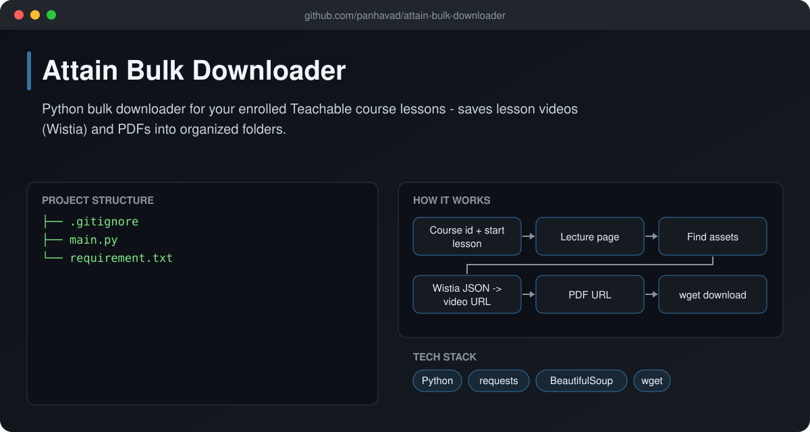
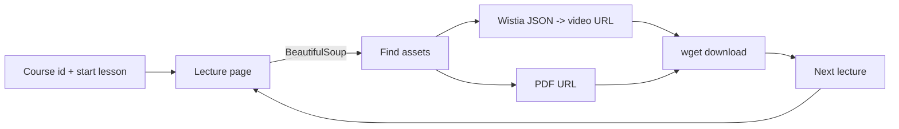

# Attain Bulk Downloader

  [](https://github.com/panhavad/attain-bulk-downloader/releases/latest)

A Python script to **back up the lessons of a Teachable course you are enrolled in** - lesson videos (Wistia) and PDF handouts - into clean, named folders for offline study. Use it only for content you have access rights to.



## Features

- Walks through course lectures from a start lesson
- Resolves Wistia video and PDF asset URLs
- Safe file / folder naming
- Uses your own logged-in session cookie

## How it works



## Getting started

```bash
pip install -r requirement.txt
python main.py
```

## Download

Grab the packaged source from the [latest release](https://github.com/panhavad/attain-bulk-downloader/releases/latest).

## Tech stack

- Python
- requests
- BeautifulSoup
- wget

## Project structure

```text
attain-bulk-downloader/
├── docs/
├── .gitignore
├── main.py
├── README.md
└── requirement.txt
```
